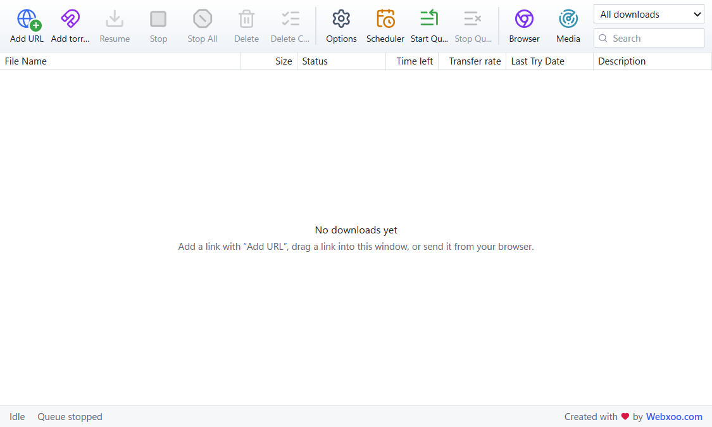
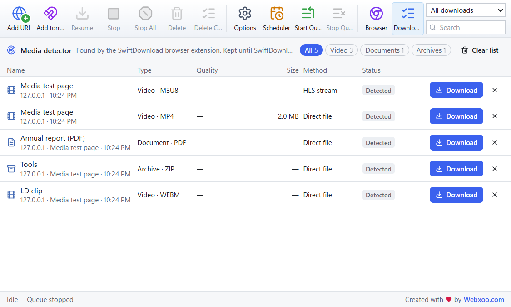
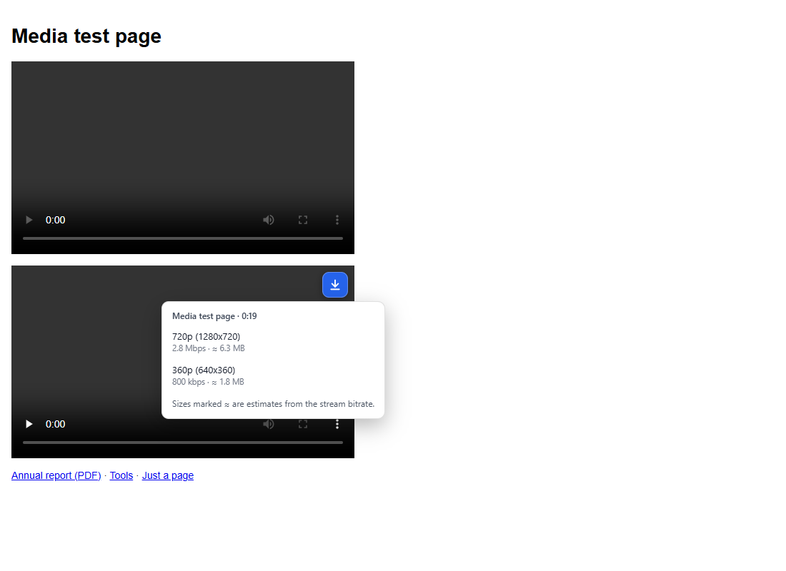
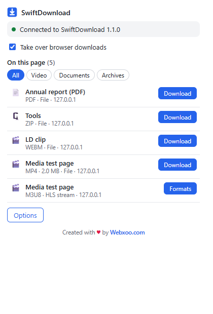
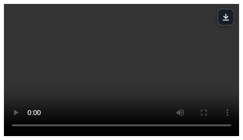

# SwiftDownload

**A fast, segmented, resumable download manager for Windows, with a browser extension that finds the videos, audio and files on the pages you visit.**

Version 1.2.0 · Windows 10/11 (64-bit) · Created with ❤️ by [Webxoo.com](https://webxoo.com)

## Features

**Download manager**
- Segmented downloads: up to 32 parallel connections per file, with pause and resume, even after a restart.
- Download queue with simultaneous-download limits, a scheduler (start/stop times and days), and an optional shutdown when everything is done.
- Global and per-download speed limits, automatic retries, and resume when the internet comes back.
- Duplicate detection, automatic categories and folders, an optional SHA-256 check, and custom headers.
- **Torrents and magnet links**, with file selection: paste a magnet link, open a `.torrent` file, or just click a magnet link in your browser.
- **HLS (`.m3u8`) and MPEG-DASH (`.mpd`) streams**: choose the quality and audio track. Segments download in parallel and resume after pauses and restarts.
- **Automatic updates**: new versions published here install themselves. Every update is verified with the release signature before it is installed.

**Browser extension** (Chrome, Edge, Brave and other Chromium browsers, plus Firefox)
- Takes over browser downloads, all files or only the types you choose, and opens magnet links in SwiftDownload.
- **Media detection** on any page: video, audio, images, documents, archives and programs, found from network responses and from the page itself.
- **Toolbar popup** listing what was found on the page, with format, size, quality and download method.
- **Download button on video and audio players**, with a quality menu for streams.
- **Download with SwiftDownload** in the right-click menu for links, images, video and audio.
- Choose which file types to detect, exclude websites, and switch automatic takeover on or off.
- Clear status when the app isn't running, and a **Reconnect** button (no browser restart needed).

**Media detector in the app**: everything the extension finds is listed under **Media**, with filters and a format/quality picker. Sizes from a stream's bitrate are always marked as estimates.

| Media detector | Choosing a stream quality on a page |
| --- | --- |
|  |  |

| Extension popup | Player download button |
| --- | --- |
|  |  |

## Documentation

- **[User guide (with pictures)](docs/USER-GUIDE.md)**: adding downloads, torrents and magnet links, queue and scheduler, the browser extension, streams, the media detector, options and shortcuts.
- **[Browser integration](docs/browser-integration.md)**: permissions, privacy, Native Messaging, troubleshooting.
- **[Changelog](CHANGELOG.md)**

## Download

| File | What it is | SHA-256 |
| --- | --- | --- |
| [`SwiftDownload_1.2.0_x64-setup.exe`](https://github.com/abdullahax7/SwiftDownload/raw/main/downloads/SwiftDownload_1.2.0_x64-setup.exe) | Installer (per user, no admin rights needed) | `ae6d2e04626c3d8a731482fbf755afa29a1825b1b55920f101ffa74b951e9a4d` |
| [`SwiftDownload-1.2.0-portable.zip`](https://github.com/abdullahax7/SwiftDownload/raw/main/downloads/SwiftDownload-1.2.0-portable.zip) | Portable version: unzip and run | `c857a4c02a2b50a2e563bf06c563c2951b8506e4fc1a2f43c1fd64b22b67620f` |
| [`extension/`](extension) | Browser extension (also included in both downloads) | |

> The program isn't code-signed yet, so Windows SmartScreen may show "Windows protected your PC". Click **More info → Run anyway**. You can check the SHA-256 values above with `Get-FileHash <file>` in PowerShell.

**Requirements:** Windows 10 or 11 (64-bit) and the Microsoft Edge WebView2 Runtime, which is included in Windows 11 and installed automatically if missing.

## Installation

### 1. Install the app
Run `SwiftDownload_1.2.0_x64-setup.exe` and start SwiftDownload. It connects itself to Chrome, Edge, Brave, Chromium and Firefox for your Windows user.

Portable: unzip `SwiftDownload-1.2.0-portable.zip`, keep the files together, and run `SwiftDownload.exe`.

### 2. Install the browser extension
The easiest way: in SwiftDownload, open **Options → Browser → Install in Google Chrome** (or Edge, Brave or Firefox). The browser's extensions page opens and the folder path is copied for you.

**Chrome / Edge / Brave (manually)**
1. Open `chrome://extensions` (Edge: `edge://extensions`, Brave: `brave://extensions`).
2. Turn on **Developer mode**.
3. Click **Load unpacked** and choose the `chrome-edge` folder: [`extension/chrome-edge`](extension/chrome-edge) from this repository, or `browser-extension\chromium` in the SwiftDownload installation or portable folder.

**Firefox (128 or newer)**
1. Open `about:debugging#/runtime/this-firefox`.
2. Click **Load Temporary Add-on…** and choose `manifest.json` in the `firefox` folder.
3. Click the SwiftDownload toolbar icon and **Allow access to websites** so it can detect media.

*Firefox removes temporary add-ons when it closes. A permanent install needs a Mozilla-signed version.*

### 3. Check the connection
Click the SwiftDownload icon in the browser toolbar. It should say **Connected to SwiftDownload 1.2.0**.

### Updates
From version 1.2.0 on, SwiftDownload keeps itself up to date: it checks this repository at startup and every 6 hours, and installs new versions automatically (running downloads pause and continue after the restart). If you have 1.1.0 or older, install the latest version once by hand; after that it updates itself.

## Using it

- **Download a file:** just download as usual. SwiftDownload takes over (turn this off in the popup).
- **Media on a page:** the toolbar icon shows how many items were found. Open the popup to download one, or click **Formats** to choose a stream's quality.
- **Video players:** point at a player and click the download button in its top-right corner.
- **Right-click** a link, image, video or audio: **Download with SwiftDownload**.
- **In the app:** click **Media** in the toolbar to see everything found in the browser and choose a format, folder and file name.

### Streams and FFmpeg
Streams download without any extra software. [FFmpeg](https://ffmpeg.org) is optional and only needed to:
- combine separate video and audio tracks (common in DASH and many HLS streams) into one MP4/WebM/MKV file, without re-encoding;
- convert MPEG-TS streams to MP4 (without FFmpeg they are saved as playable `.ts` files);
- download HLS streams that use AES-128 encryption.

Install FFmpeg and set its path in **Options → Media**, or put `ffmpeg.exe` in an `ffmpeg` folder next to `SwiftDownload.exe`.

## What it can't download

- **DRM-protected media is never downloaded.** Streams protected by Widevine, PlayReady, FairPlay or SAMPLE-AES (most paid streaming services) are shown as *Not supported*.
- **Live streams** aren't supported, only complete (on-demand) streams.
- **YouTube isn't supported.** YouTube's Terms of Service don't allow downloading except through YouTube's own features.
- Players that don't expose a usable source get no download button.
- Download only what you're allowed to: respect each website's terms and copyright law.

## Privacy and security

- The extension talks only to the SwiftDownload app on your computer, through the browser's **Native Messaging**. There is no web server, no remote code, and nothing is sent to the internet.
- It sends the app only download/media links, the page address and title, file names and the browser's User-Agent. Cookies are sent **only if you turn that option on**, and only for the address being downloaded.
- Every message is checked by the extension, by the native host and by the app. Only four message types exist (ping, add, detected, inspect); nothing received can run a program or choose where a file is saved.
- Saved browser session data is encrypted with Windows DPAPI. It's never shown in the app, logs or diagnostics, and for streams it's only sent to the server the stream came from.
- Detected media lists are kept in memory and cleared when the browser or app closes.
- SwiftDownload never opens or runs downloaded files by itself.

Details: [docs/browser-integration.md](docs/browser-integration.md), covering permissions, Native Messaging registration, settings and troubleshooting.

## Troubleshooting

| Problem | Solution |
| --- | --- |
| Popup says *SwiftDownload is not running* | Start SwiftDownload, then click **Reconnect**. |
| Popup says *not connected to this browser* | SwiftDownload → **Options → Browser → Register**, then click **Reconnect**. |
| Nothing is detected | Start playing the video. Check that the site isn't excluded and the file type is selected in the extension's Options. In Firefox, allow access to websites. |
| *Needs FFmpeg* | Install FFmpeg (see above), or choose a quality that includes audio. |
| A stream fails with *refused access* or *no longer available* | Its link expired: reload the page and download again. |
| The download went to the browser instead | SwiftDownload wasn't reachable, so the browser kept the download and nothing is lost. |
| Still stuck? | Email [contact@webxoo.com](mailto:contact@webxoo.com) with the details listed under [Support and contact](#support-and-contact). |

## Support and contact

Found a bug, need help, or want a new feature or an update? Email **[contact@webxoo.com](mailto:contact@webxoo.com)**.

When reporting a bug, please include:
- your SwiftDownload version (Options → About) and Windows version;
- your browser and its version;
- what you did, what you expected and what happened;
- the page or link (if you can share it) and any error message;
- a diagnostic report, if possible: **Options → Storage → Diagnostic report → Export…**. Passwords, cookies, sign-in headers and link details are removed automatically.

## What's new
See [CHANGELOG.md](CHANGELOG.md).

---

**Created with ❤️ by [Webxoo.com](https://webxoo.com)** · Bugs, help and updates: [contact@webxoo.com](mailto:contact@webxoo.com)

