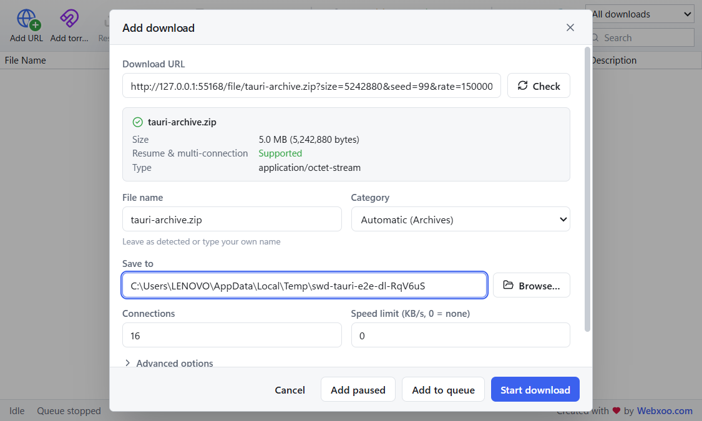
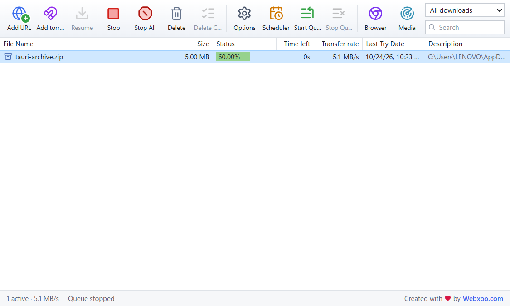
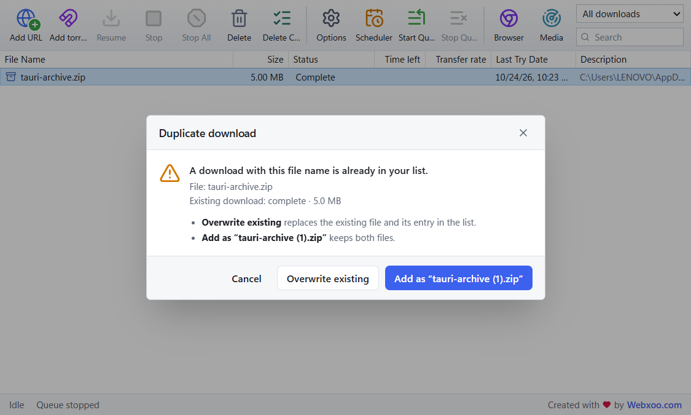
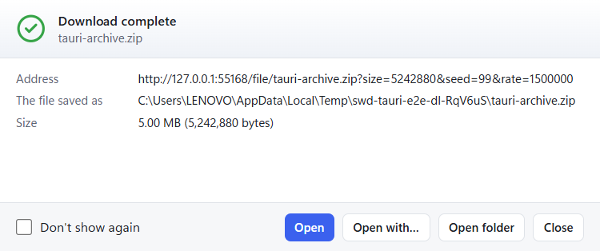
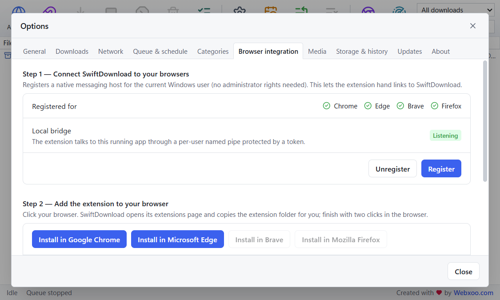
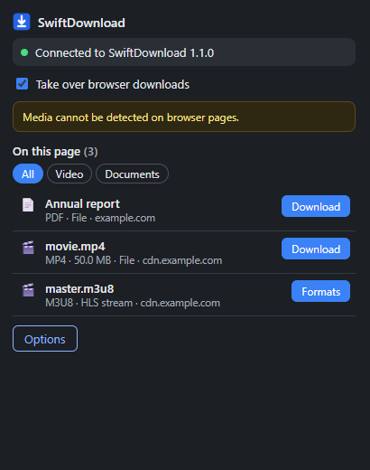
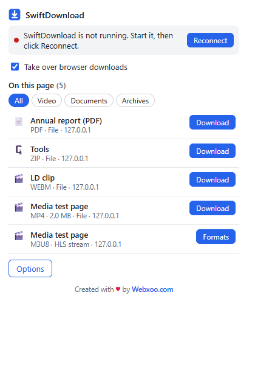
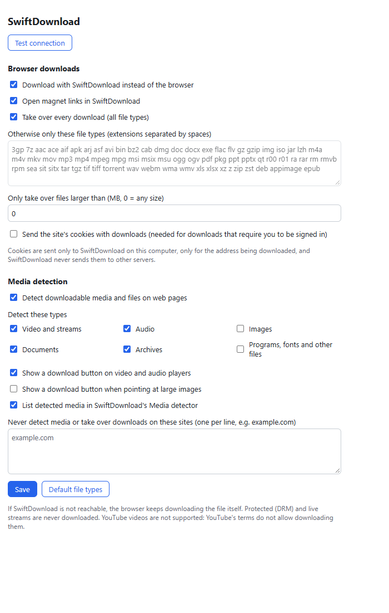
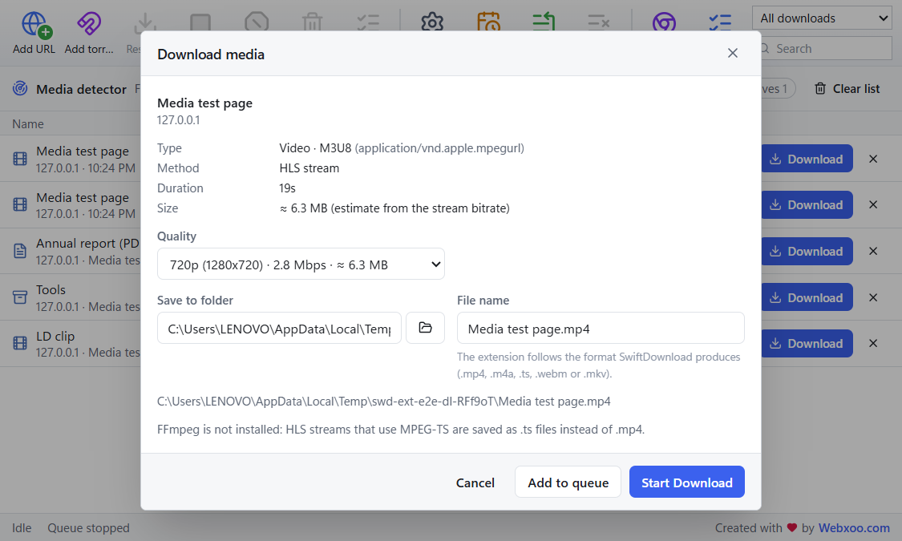
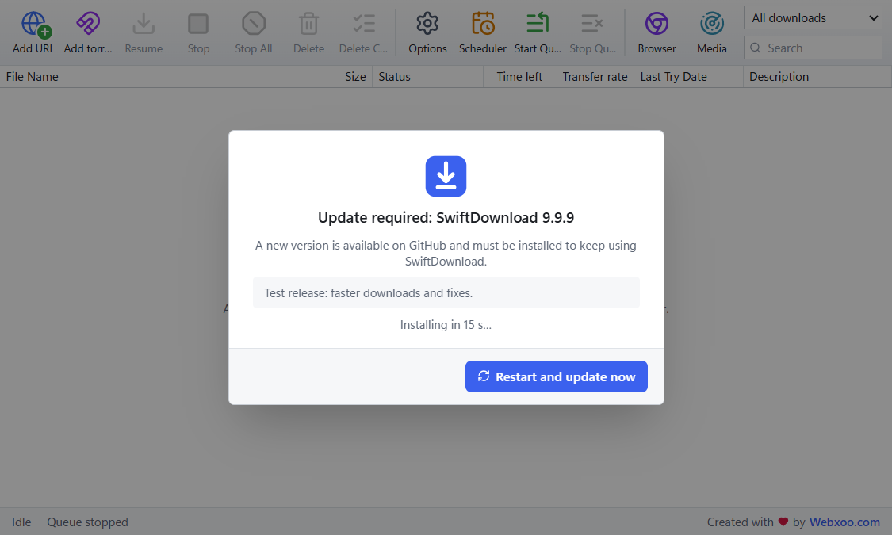

# SwiftDownload user guide

Everything SwiftDownload can do, step by step. New here? Start with [Installation](../README.md#installation).

**Contents**
1. [The main window](#1-the-main-window)
2. [Adding a download](#2-adding-a-download)
3. [Torrents and magnet links](#3-torrents-and-magnet-links)
4. [Watching and managing downloads](#4-watching-and-managing-downloads)
5. [Duplicates and finished downloads](#5-duplicates-and-finished-downloads)
6. [Queue, scheduler and speed limits](#6-queue-scheduler-and-speed-limits)
7. [Browser integration](#7-browser-integration)
8. [The browser extension](#8-the-browser-extension)
9. [Video and audio streams (HLS / DASH)](#9-video-and-audio-streams-hls--dash)
10. [Media detector in the app](#10-media-detector-in-the-app)
11. [Options overview](#11-options-overview)
12. [Keyboard shortcuts](#12-keyboard-shortcuts)
13. [Automatic updates](#13-automatic-updates)
14. [Help and contact](#14-help-and-contact)

---

## 1. The main window

| Toolbar button | What it does |
| --- | --- |
| **Add URL** | Add a download from a web link (also Ctrl+N) |
| **Add torrent** | Add a magnet link, a `.torrent` file or a link to a `.torrent` file |
| **Resume / Stop / Stop All** | Resume or pause the selected downloads, or pause everything |
| **Delete / Delete Completed** | Remove downloads from the list (optionally also the files) |
| **Options** | All settings |
| **Scheduler / Start Queue / Stop Queue** | Run the download queue now or at set times |
| **Browser** | Connect SwiftDownload to your browsers |
| **Media** | Media and files found by the browser extension (click again for the download list) |

At the right: filter the list (all, unfinished, finished, queued, paused, failed, video & audio, or a category) and search it.
The status bar at the bottom shows the activity, the queue state and any speed limit.

You can also **drag a link** from your browser onto the window to add it. Magnet links dragged in open the torrent dialog.

## 2. Adding a download

Click **Add URL** and paste a link. SwiftDownload checks it straight away:

- **File name, size and type** are read from the server. *Resume & multi-connection: Supported* means the file downloads in several parts at once and can be paused and resumed.
- **Category** is chosen automatically from the file type (documents, programs, archives, images, videos, audio, other). Each category can have its own folder.
- **Save to**: the destination folder.
- **Connections**: how many parts download in parallel (1–32).
- **Speed limit**: per download, in KB/s (0 = no limit).
- **Advanced options**: custom request headers (for example an `Authorization` header), a referrer and a SHA-256 checksum to verify the finished file.
- Start it now (**Start download**), put it in the queue (**Add to queue**) or keep it paused (**Add paused**).

Links to HLS (`.m3u8`) and DASH (`.mpd`) streams can be pasted here too (see [section 9](#9-video-and-audio-streams-hls--dash)).

## 3. Torrents and magnet links

SwiftDownload downloads **torrents** with its built-in BitTorrent engine. No other program is needed.

**Ways to add a torrent**
- Click **Add torrent** and paste a **magnet link** (`magnet:?xt=urn:btih:…`) or a link to a `.torrent` file, or click the folder button to choose a `.torrent` file on your computer.
- **Click a magnet link on any website**: with the browser extension installed, it opens in SwiftDownload instead of another torrent program.
- **Right-click a magnet link** → **Download with SwiftDownload**.
- **Drag** a magnet link onto the SwiftDownload window.
- Open a `.torrent` file with SwiftDownload (right-click the file → *Open with*).

**In the torrent dialog**
- SwiftDownload reads the torrent's details: its name, total size and the list of files. For a magnet link these come from other peers, which can take a moment. If no peers answer in time you can still add it, and the download starts as soon as peers are found.
- **Choose which files to download**: tick only the files you want.
- Pick the destination folder (a torrent with several files gets its own folder, which you can rename), then **Start**, **Add to queue** or **Add paused**.

Torrents appear in the same list as other downloads, with progress, speed, pause/resume and speed limits. **Properties** (double-click a torrent) shows each file's progress.

## 4. Watching and managing downloads

- The list shows each download's progress, size, time left and speed. Stream downloads show their segments, for example *45.0% (27/60)*, and their size is marked **≈** (an estimate) until they finish.
- **Double-click** a download for **Properties**: address, folder, connection details and a live map of the downloaded parts. A download can be renamed there before it starts.
- **Right-click** for more: open, open folder, open with, copy the download address, queue order (top, up, down, bottom), speed limit, redownload and delete.
- Stopped and failed downloads resume where they left off, even after a restart of the computer. If the internet connection drops, downloads continue when it comes back.

## 5. Duplicates and finished downloads

If you add something that is already in the list, or a file with that name already exists, SwiftDownload asks what to do:

When a download finishes, a small window lets you open the file or its folder (you can turn this off):

SwiftDownload never opens or runs a downloaded file by itself.

## 6. Queue, scheduler and speed limits

- **Queue**: downloads added with *Add to queue* start when the queue runs, a few at a time (**Options → Downloads → simultaneous downloads**). Use **Start Queue / Stop Queue** in the toolbar.
- **Scheduler** (**Options → Queue & schedule**): start the queue at a set time on chosen days, and optionally stop it later (overnight windows work).
- **Shut down when done**: turn the computer off when all downloads have finished. Windows gives a 60-second warning you can cancel.
- **Speed limits**: a global limit (**Options → Network**) and a limit per download.
- **Proxy**: none, the system proxy, or your own (**Options → Network**).

## 7. Browser integration

SwiftDownload connects to Chrome, Edge, Brave, Chromium and Firefox for your Windows user, automatically when it starts. You can check this, or do it again, in **Options → Browser integration**:

- **Step 1**: shows the browsers SwiftDownload is registered with. **Register** repeats it; **Unregister** removes it.
- **Step 2**: **Install in Google Chrome** (or Edge, Brave, Firefox) opens the browser's extensions page and copies the extension folder path for you. In Chrome/Edge/Brave: turn on *Developer mode*, click *Load unpacked*, and paste the path.

## 8. The browser extension

Click the SwiftDownload icon in the browser toolbar:

| Light | Dark |
| --- | --- |
|  |  |

- **Connection status** at the top. If SwiftDownload isn't running, start it and click **Reconnect**; there's no need to restart the browser.

  
- **Take over browser downloads**: when on, files you download in the browser go to SwiftDownload. If SwiftDownload can't be reached, the browser keeps the download, so nothing is lost.
- **On this page**: the videos, audio, documents, archives and other files found on the page, with format, size and how they would be downloaded. Filter by type, then click **Download**, or **Formats** for streams.
- The number on the toolbar icon shows how many items were found on the current page.

**Download button on players.** Point at a video or audio player; a button appears in its top-right corner (it never covers the player's controls). One click downloads a direct file; for streams it lists the qualities:

| Button | Choosing a quality |
| --- | --- |
|  |  |

**Right-click menu:** right-click a link, image, video or audio → **Download with SwiftDownload**. This works for magnet links too.

**Extension options** (right-click the icon → *Options*):

- Which downloads to take over (all, or only some file types; a minimum size).
- Open magnet links in SwiftDownload.
- Send the site's cookies, needed for downloads that require you to be signed in. Off by default.
- Media detection on or off, and which types to detect: video and streams, audio, images, documents, archives, programs/fonts/other.
- Show the player button and the image button (for large images).
- List detected media in the app.
- **Excluded sites**: no detection and no download takeover on these websites.

## 9. Video and audio streams (HLS / DASH)

Many websites play video as a **stream**: an `.m3u8` (HLS) or `.mpd` (DASH) playlist plus many small pieces. SwiftDownload:
- reads the playlist and shows the **real qualities** (resolution, bitrate) and audio tracks;
- downloads the pieces **in parallel** (1–16 at a time, **Options → Media**), retries failed ones, and **resumes** after a pause or restart without downloading finished pieces again;
- joins them into one file on disk.

**FFmpeg (optional)** is used to combine separate video and audio tracks into one MP4/WebM/MKV file without re-encoding, to turn MPEG-TS streams into MP4, and for AES-128 encrypted HLS. Without FFmpeg, streams with video and audio together are saved as `.ts` (plays in VLC, MPC-HC and most players). Set FFmpeg in **Options → Media**, or put `ffmpeg.exe` in an `ffmpeg` folder next to `SwiftDownload.exe`.

**Not supported:** DRM-protected streams (most paid streaming services), live streams, and YouTube (its terms don't allow downloading). These are clearly marked *Not supported* instead of failing silently.

## 10. Media detector in the app

Click **Media** in the toolbar to see everything the extension found while you browse:

- Filter by type, see the site, format, quality, size, method and status.
- **Download** opens the format picker. For streams it shows each quality with its bitrate and estimated size, the audio tracks, the folder and the file name:

- Sizes marked **≈** are estimates calculated from the stream bitrate.
- If a combination needs FFmpeg and it isn't installed, the dialog says so before anything is downloaded.
- The list lives in memory only and is cleared when SwiftDownload closes. Click **Clear list** to empty it, or **✕** to remove one item.

## 11. Options overview

| Tab | Settings |
| --- | --- |
| **General** | Theme (light, dark, system), start with Windows, minimise/close to tray, notifications, completion window, default folder, confirmations, confirm downloads sent from the browser |
| **Downloads** | Connections per download, simultaneous downloads, retries, resume at startup, file name conflicts, category folders |
| **Network** | Timeouts, global and per-download speed limits, proxy, User-Agent |
| **Queue & schedule** | Start/stop the queue, schedule, shut down when done |
| **Categories** | File types and folders per category; add your own |
| **Browser integration** | Register with browsers, install the extension |
| **Media** | Parallel stream segments, media detector on/off, FFmpeg location |
| **Storage & history** | Database and log locations, diagnostic report, clear history |
| **About** | Version and edition |

## 12. Keyboard shortcuts

| Keys | Action |
| --- | --- |
| Ctrl+N | Add URL |
| Ctrl+, | Options |
| Ctrl+R | Resume the selected downloads |
| Ctrl+P | Stop the selected downloads |
| Ctrl+F | Search the list |
| Ctrl+A | Select all |
| Delete | Delete the selected downloads |
| Alt+Enter | Properties |
| Esc | Clear the selection |
| Ctrl+Q | Exit SwiftDownload |

## 13. Automatic updates

SwiftDownload updates itself from this GitHub repository (version 1.2.0 and newer):

- It checks at startup and every 6 hours.
- When a new version is published, a window shows the new version and its notes. The update downloads, is **verified with the release signature** (an update that was tampered with is rejected), and installs by itself after a short countdown. You can also click **Restart and update now**.
- Downloads that are running pause and **continue after the restart**.
- **Updates are required.** Until the new version is installed, SwiftDownload can't be used: running downloads stay paused, new ones are refused (downloads from the browser stay in the browser), and this stays so after a restart or without internet.
- If the update can't be downloaded (for example, no internet), it is retried every minute. You can also click **Download from GitHub** and install the new version yourself.

The current status is in **Options → Updates**.

## 14. Help and contact

Found a bug, need help, or want an update? Email **[contact@webxoo.com](mailto:contact@webxoo.com)**.
Please attach a diagnostic report: **Options → Storage & history → Diagnostic report → Export…**. Passwords, cookies, sign-in headers and link details are removed automatically.

More technical details (permissions, privacy, troubleshooting): [browser-integration.md](browser-integration.md).

---

Created with ❤️ by [Webxoo.com](https://webxoo.com)
